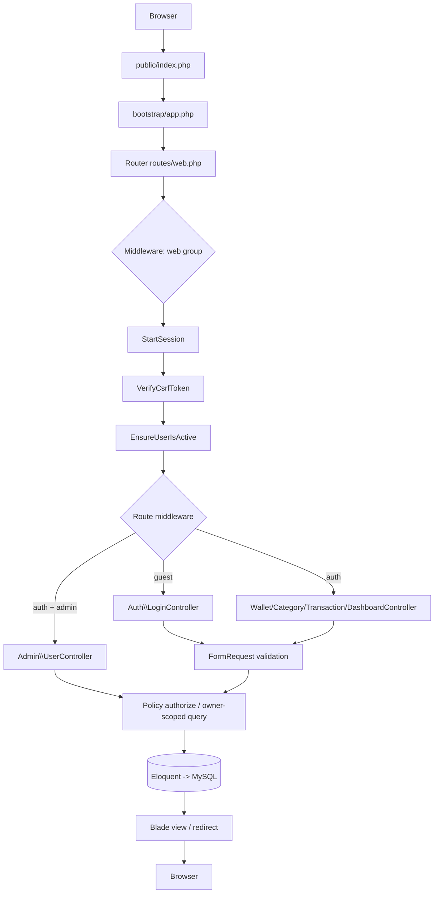

# Architecture — Catatku

A server-rendered application: one request enters through the router, passes middleware, reaches
a controller, is validated by a FormRequest, touches Eloquent, and returns Blade or a redirect.
There is no API, no SPA and no service layer.

## One request end to end

The concrete path for `GET /transactions?month=2026-08`:

1. `routes/web.php:28` — the resource route inside the `auth` group.
2. `EnsureUserIsActive` (`app/Http/Middleware/EnsureUserIsActive.php`) — a deactivated user is
   logged out immediately.
3. `TransactionFilterRequest` — `month`, `type` and `category_id` are validated before use.
4. `TransactionController::index` — the query is built from `$user->transactions()`.
5. `scopeForMonth` (`app/Models/Transaction.php:69`) adds the date range.
6. `paginate(15)->withQueryString()` returns the paginator.
7. `resources/views/transactions/index.blade.php` renders the table, filters and pagination.

## Routing table

Produced by `php artisan route:list --except-vendor` (29 routes).

### Public

| Method | URI | Name | Handler | Middleware |
| --- | --- | --- | --- | --- |
| GET | `/` | — | redirect to dashboard or login | web |
| GET | `/register` | `register` | `Auth\RegisterController@create` | guest |
| POST | `/register` | — | `Auth\RegisterController@store` | guest + `throttle:6,1` |
| GET | `/login` | `login` | `Auth\LoginController@create` | guest |
| POST | `/login` | — | `Auth\LoginController@store` | guest + `throttle:5,1` |

### Login required

| Method | URI | Name | Handler |
| --- | --- | --- | --- |
| GET | `/dashboard` | `dashboard` | `DashboardController` (invokable) |
| GET | `/transactions` | `transactions.index` | `TransactionController@index` |
| POST | `/transactions` | `transactions.store` | `TransactionController@store` |
| GET | `/transactions/create` | `transactions.create` | `TransactionController@create` |
| GET | `/transactions/{transaction}/edit` | `transactions.edit` | `TransactionController@edit` |
| PUT/PATCH | `/transactions/{transaction}` | `transactions.update` | `TransactionController@update` |
| DELETE | `/transactions/{transaction}` | `transactions.destroy` | `TransactionController@destroy` |
| GET | `/wallets` | `wallets.index` | `WalletController@index` |
| POST | `/wallets` | `wallets.store` | `WalletController@store` |
| GET | `/wallets/create` | `wallets.create` | `WalletController@create` |
| GET | `/wallets/{wallet}/edit` | `wallets.edit` | `WalletController@edit` |
| PUT/PATCH | `/wallets/{wallet}` | `wallets.update` | `WalletController@update` |
| DELETE | `/wallets/{wallet}` | `wallets.destroy` | `WalletController@destroy` |
| GET | `/categories` | `categories.index` | `CategoryController@index` |
| POST | `/categories` | `categories.store` | `CategoryController@store` |
| GET | `/categories/create` | `categories.create` | `CategoryController@create` |
| GET | `/categories/{category}/edit` | `categories.edit` | `CategoryController@edit` |
| PUT/PATCH | `/categories/{category}` | `categories.update` | `CategoryController@update` |
| DELETE | `/categories/{category}` | `categories.destroy` | `CategoryController@destroy` |
| POST | `/logout` | `logout` | `Auth\LogoutController@destroy` |

### Login + admin role required

| Method | URI | Name | Handler |
| --- | --- | --- | --- |
| GET | `/admin/users` | `admin.users.index` | `Admin\UserController@index` |
| POST | `/admin/users/{user}/deactivate` | `admin.users.deactivate` | `Admin\UserController@deactivate` |
| POST | `/admin/users/{user}/activate` | `admin.users.activate` | `Admin\UserController@activate` |
| DELETE | `/admin/users/{user}` | `admin.users.destroy` | `Admin\UserController@destroy` |

## Layers and responsibilities

| Layer | Location | Content |
| --- | --- | --- |
| Routing | `routes/web.php` | three groups: `guest`, `auth`, `auth` + `admin` |
| Middleware | `app/Http/Middleware`, `bootstrap/app.php` | `EnsureUserIsActive` (web group), `EnsureUserIsAdmin` (alias `admin`) |
| Validation | `app/Http/Requests` | one request per resource, shared by store and update |
| Authorization | `app/Policies`, owner-scoped queries | policies for ids from the URL, user relationships for lists |
| Domain | `app/Models`, `app/Enums` | relationships, casts, scopes, enum labels and icons |
| Aggregation | `app/Support` | `MonthlySummary`, `Money` |
| Presentation | `resources/views` | layout, components, one page per resource |

There is no repository, DTO or service layer: controllers are thin, query logic lives in the
models, and the only helper classes are the dashboard aggregation and the money formatter.
