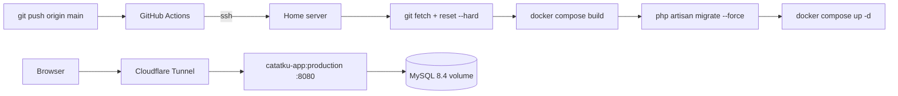

# Deployment

Target: a home server running the `production` stage of `docker/Dockerfile` behind a
Cloudflare Tunnel, deployed by a GitHub Actions workflow over SSH. No Railway, no
managed database: the app and its MySQL run as two containers on the same host.



## 1. Production image, verified locally

```bash
docker build -f docker/Dockerfile --target production -t catatku-prod .
```

The image is `php:8.4-apache` with `mod_rewrite`, the Vite assets copied from the Node
stage, `composer install --no-dev --optimize-autoloader`, and it runs as `www-data` on
`$PORT` (default 8080).

Run it against the local MySQL to prove it boots without the dev stack:

```bash
podman run -d --name catatku-prod-test --network catatku_default -p 8002:8080 \
  -e APP_ENV=production -e APP_DEBUG=false -e APP_KEY="$(php artisan key:generate --show)" \
  -e APP_URL=https://catatku.example.test -e APP_LOCALE=id -e LOG_CHANNEL=stderr \
  -e DB_CONNECTION=mysql -e DB_HOST=db -e DB_PORT=3306 \
  -e DB_DATABASE=catatku -e DB_USERNAME=catatku -e DB_PASSWORD=catatku \
  -e SESSION_DRIVER=database -e CACHE_STORE=database -e QUEUE_CONNECTION=sync \
  -e SESSION_SECURE_COOKIE=false catatku-prod
```

Result (real output):

```text
podman exec catatku-prod-test id      -> uid=33(www-data) gid=33(www-data)
GET /up                               -> 200
GET /                                -> 302, Location: https://localhost:8002/login
GET /login                            -> 200, contains name="_token"
GET /halaman-tidak-ada                -> 404, no stack trace, no vendor path
POST /login (budi@catatku.test)       -> 302, Location: https://localhost:8002/dashboard
GET /dashboard with the session       -> 200, shows "Budi Santoso"
mysql> SELECT COUNT(*) FROM sessions  -> 2
Set-Cookie: catatku-session=...; httponly; samesite=lax
```

With `SESSION_SECURE_COOKIE=true` (the production setting) the same cookie becomes
`secure; httponly; samesite=lax`.

Two pieces of code make that output possible:

- `bootstrap/app.php` -> `$middleware->trustProxies(at: '*')`, because the tunnel
  terminates TLS and only the forwarded headers reveal the real scheme and client IP.
- `AppServiceProvider::boot()` -> `URL::forceScheme('https')` in production, so
  generated URLs and redirects never fall back to `http`.

## 2. Server prerequisites

| Requirement | Why |
| --- | --- |
| Docker Engine + Compose v2 | `docker-compose.production.yml` is a Compose v2 file |
| Git | The workflow pulls `main` on the server |
| A clone at a fixed path, e.g. `/srv/catatku` | That path is the `APP_PATH` secret |
| Cloudflare Tunnel client | Terminates TLS and forwards to the app port |
| Port 8080 free (or `APP_PORT` set) | The app container publishes it |

## 3. First-time server setup

```bash
sudo mkdir -p /srv/catatku && sudo chown "$USER" /srv/catatku
git clone git@github.com:<owner>/Catatku.git /srv/catatku
cd /srv/catatku
cp .env.example .env
chmod 600 .env
```

Edit `.env` on the server. These values differ from development:

| Variable | Production value |
| --- | --- |
| `APP_ENV` | `production` |
| `APP_DEBUG` | `false` |
| `APP_KEY` | `php artisan key:generate --show` run once, then pasted |
| `APP_URL` | `https://catatku.<your-domain>` |
| `LOG_CHANNEL` | `stderr` |
| `SESSION_SECURE_COOKIE` | `true` |
| `DB_HOST` | `db` |
| `DB_DATABASE` / `DB_USERNAME` | database name and user for this server (keep the example values if you like) |
| `DB_PASSWORD` / `DB_ROOT_PASSWORD` | real secrets, not the example values |
| `APP_PORT` | host port for the app container, default `8080`; set `127.0.0.1:8080` when `cloudflared` runs on the same host |

Everything else stays as it is in `.env.example`: `SESSION_DRIVER=database`,
`CACHE_STORE=database`, `QUEUE_CONNECTION=sync`, `APP_LOCALE=id`, `DB_CONNECTION=mysql`,
`DB_PORT=3306`.

`.env` is untracked, so the deploy's `git reset --hard` never overwrites or deletes it.

First boot:

```bash
docker compose -f docker-compose.production.yml build
docker compose -f docker-compose.production.yml run --rm app php artisan migrate --force
docker compose -f docker-compose.production.yml run --rm app php artisan db:seed --force
docker compose -f docker-compose.production.yml up -d
```

`db:seed --force` runs exactly once: the seeders are not idempotent and would duplicate
the demo rows on every deploy, which is why the workflow never calls them.

## 4. GitHub Actions secrets

The workflow (`.github/workflows/deploy.yml`) runs on every push to `main` and on
`workflow_dispatch`.

| Secret | Content | Where the value comes from |
| --- | --- | --- |
| `SSH_HOST` | hostname the runner connects to | the SSH hostname published through the tunnel, e.g. `ssh.<domain>` (see §4b). **Not** an IP address when the server has no public one |
| `SSH_USER` | user that owns the clone and can run `docker` | `whoami` on the server |
| `SSH_PRIVATE_KEY` | whole private key, from `-----BEGIN` to `-----END` | `ssh-keygen -t ed25519 -f ~/.ssh/catatku_deploy -N ""` then `cat ~/.ssh/catatku_deploy`; the matching `.pub` goes into the server's `~/.ssh/authorized_keys` |
| `APP_PATH` | absolute path of the clone | `pwd` inside the clone on the server, e.g. `/srv/catatku` |
| `CF_ACCESS_CLIENT_ID` | Access service token id, `<32 hex>.access` | Zero Trust → Access → Service credentials → Service tokens (see §4b). Optional: only when the host is reached through the tunnel |
| `CF_ACCESS_CLIENT_SECRET` | the matching secret, `cfast_…` or 64 hex | same screen, shown only once at creation |

`CF_ACCESS_CLIENT_ID` and `CF_ACCESS_CLIENT_SECRET` are optional as a pair: set both to go
through the tunnel, leave both empty for a host with a public SSH port. Setting only one fails
the first step with an explicit message.

Nothing else has to be configured in GitHub: the workflow does not use `GITHUB_TOKEN`, so no
Actions permission changes are needed. Database passwords live in the server's `.env` (§3) and
never become repository secrets.

The workflow does, over SSH:

0. verifies the login and `docker compose version` before touching anything
1. `git fetch --prune origin main` + `git reset --hard origin/main`
2. `docker compose -f docker-compose.production.yml build`
3. `docker compose -f docker-compose.production.yml run --rm app php artisan migrate --force`
4. `docker compose -f docker-compose.production.yml up -d --remove-orphans`

Migrations run with the new image while the previous container still serves traffic, so
a failed migration leaves the running app untouched.

## 5. Cloudflare Tunnel

Point a public hostname at the app port, for example in `~/.cloudflared/config.yml`:

```yaml
tunnel: catatku
ingress:
  - hostname: catatku.<your-domain>
    service: http://localhost:8080
  - service: http_status:404
```

`cloudflared` sends `X-Forwarded-Proto: https`, which is why the trusted-proxy
configuration above matters.

## 6. Live verification checklist

Run these against `https://catatku.<your-domain>` after the first deploy:

- [ ] `GET /` -> `302` to `/login` with an `https` location
- [ ] `GET /login` -> `200`, form contains `name="_token"`
- [ ] `POST /login` without a token -> `419`
- [ ] login `budi@catatku.test` / `password` -> dashboard shows the user name
- [ ] `POST /logout` -> back to `/login`, and `/dashboard` redirects again
- [ ] response cookie is `secure; httponly; samesite=lax`
- [ ] `GET /halaman-tidak-ada` -> the Indonesian 404 page, no stack trace
- [ ] `GET /up` -> `200`

## 7. Problems found and how they were fixed

| Problem | Fix |
| --- | --- |
| Redirects pointed at `http://` behind the TLS proxy | `trustProxies(at: '*')` + `URL::forceScheme('https')` in production |
| `SESSION_SECURE_COOKIE` at its default would send the session over http | Set to `true` on the server; the `secure` flag was verified on a local production container |
| `docker build .` fails because the Dockerfile is not at the repository root | Always build with `-f docker/Dockerfile` |
| `config:cache` is not run at build time, so no `.env` values are baked into the image | Configuration is read from the injected environment at runtime |
| A failing migration would take the old container down if it ran after `up -d` | The workflow migrates before `up -d` |
| `podman-compose` keeps the old container after a rebuild on the dev machine | `docker compose up -d --build --force-recreate app` |

## 8. Subsequent deploys

```bash
git push origin main        # GitHub Actions rebuilds, migrates and restarts
```

Production database changes happen only through `php artisan migrate --force`. Never run
`migrate:fresh`, `db:wipe` or `migrate:rollback` against the server database.

## 9. Final verification — local dry run of the production image

The server is not reachable from this machine yet, so the same steps the workflow runs were
executed against a **fresh database** with the built image before deploying. This is the
closest possible rehearsal of the live checklist.

```bash
docker build -f docker/Dockerfile --target production -t catatku-prod:final .
# fresh database, so the seeders run on an empty schema
mysql -e "CREATE DATABASE catatku_prod; GRANT ALL ON catatku_prod.* TO 'catatku'@'%';"

podman run -d --name catatku-final --network catatku_default -p 8004:8080 \
  -e APP_ENV=production -e APP_DEBUG=false -e APP_KEY=... -e APP_URL=https://catatku.contoh.test \
  -e DB_HOST=db -e DB_DATABASE=catatku_prod -e DB_USERNAME=catatku -e DB_PASSWORD=... \
  -e SESSION_DRIVER=database -e CACHE_STORE=database -e QUEUE_CONNECTION=sync \
  -e SESSION_SECURE_COOKIE=false catatku-prod:final

podman exec catatku-final php artisan migrate --force
podman exec catatku-final php artisan db:seed --force
```

Result (real output, 31 October 2026):

```text
podman exec catatku-final id          -> uid=33(www-data) gid=33(www-data)
GET  /up                              -> 200
GET  /                                -> 302 https://localhost:8004/login
GET  /login                            -> 200, contains name="_token"
POST /login without a token            -> 419
POST /login (budi@catatku.test)        -> 302 https://localhost:8004/dashboard
   Set-Cookie: catatku-session=...; httponly; samesite=lax
GET  /dashboard                        -> 200, Rp 9.500.000 / Rp 1.190.000 / Rp 8.310.000,
                                          chart data attribute present, wallet balances
GET  /transactions                     -> 200, "Halaman 1 dari 2"
GET  /transactions?month=2026-08&type=income -> 200, only "Gaji bulan Agustus"
GET  /wallets, /categories             -> 200, 200
GET  /tidak-ada                        -> 404 "Halaman tidak ditemukan", no stack trace
POST /transactions (valid)             -> 302, row created with user_id forced to the owner
POST /transactions (type mismatch)     -> 302 back with the mismatch message
admin GET /admin/users                 -> 200, "Akun kamu", "31 transaksi"
budi  GET /admin/users                 -> 403
POST /logout                           -> 302 https://localhost:8004/login
GET  /dashboard after logout           -> 302
```

`SESSION_SECURE_COOKIE` is `false` in this rehearsal because the container is reached over
plain HTTP on localhost; with `true` the same cookie carries `secure` (verified in §1).

The scratch database and container were removed afterwards:
`DROP DATABASE catatku_prod`, `podman rm -f catatku-final`. The development database was not
touched (`users=3`, `transactions=60` before and after).

### What is still unverified

- The live host itself: DNS, Cloudflare Tunnel routing, the four Actions secrets, and the
  server's `.env`. These cannot be exercised without access.
- Visual rendering in a browser (chart, 375px layout) and the screenshots in
  `docs/submission-checklist.md` §3.
- The `v1.0.0` tag is intentionally **not** created yet: it should mark a commit that passed
  the live checklist, not a rehearsal.

## 4b. SSH through Cloudflare Tunnel (no public IP)

The runner sits on the public internet, so `ssh` to the server only works if port 22 is
reachable. When the host has no public IP, publish SSH through the same tunnel and let
`cloudflared` on the runner open the connection — the tunnel is outbound from the server, so
no inbound port is ever opened.

1. **Publish the SSH route.** Dashboard → **Networking** → **Tunnels** → your tunnel →
   **Routes** → **Add route** → **Published application**. Pick your zone and the subdomain
   `ssh`, then set the service to **SSH** with `localhost:22` (or `<server IP>:22` when the
   tunnel runs on a different machine than the SSH server).
2. **Protect it with Access.** Zero Trust → **Access** → **Applications** → add a
   self-hosted application for `ssh.<domain>` with a policy whose action is **Service Auth**.
   Without this, Access asks for a browser login that the runner cannot complete.
3. **Create the token.** Zero Trust → **Access** → **Service credentials** → **Service
   tokens** → **Create Service Token**. Copy the Client ID (`<32 hex>.access`) and the Client
   Secret (shown once; `cfast_…` on new accounts, 64 hex on older ones).
4. **Fill the secrets.** `SSH_HOST=ssh.<domain>`, `CF_ACCESS_CLIENT_ID`,
   `CF_ACCESS_CLIENT_SECRET` — see the table in §4.

The workflow then downloads `cloudflared` and writes this `~/.ssh/config` (mode 600):

```text
Host ssh.<domain>
  User deploy
  IdentityFile ~/.ssh/deploy_key
  IdentitiesOnly yes
  StrictHostKeyChecking accept-new
  ProxyCommand ~/.local/bin/cloudflared access ssh --hostname %h --service-token-id <id> --service-token-secret <secret>
```

The token is passed as flags instead of `TUNNEL_SERVICE_TOKEN_ID` / `TUNNEL_SERVICE_TOKEN_SECRET`
because `cloudflared access ssh` does not honour those variables on every version; the flags
work everywhere. `StrictHostKeyChecking accept-new` pins the host key on the first connection
and refuses a changed key afterwards. The runner is destroyed when the job ends, so the copy of
the token on disk only lives for the duration of the deploy.

Reproduce the exact same path from your laptop before trusting CI:

```bash
ssh -F ~/.ssh/config deploy@ssh.<domain> 'cd /srv/catatku && git log -1 --oneline'
```

with the `ProxyCommand` line above in your own `~/.ssh/config`, or directly:

```bash
cloudflared access ssh --hostname ssh.<domain> \
  --service-token-id "$CF_ACCESS_CLIENT_ID" \
  --service-token-secret "$CF_ACCESS_CLIENT_SECRET"
```

If the host does have a public IP and port 22 open, skip this section entirely: leave both
`CF_*` secrets empty and the workflow falls back to `ssh-keyscan` plus a plain `ssh`.

## 4c. Kegagalan workflow yang umum

| Gejala | Penyebab | Perbaikan |
| --- | --- | --- |
| Gagal di `Check required secrets`, pesan "is empty or missing" | nama secret salah atau nilainya kosong | buat ulang dengan nama persis: `SSH_HOST`, `SSH_USER`, `SSH_PRIVATE_KEY`, `APP_PATH` |
| Gagal di `Check required secrets`, pesan format key | private key ditempel sebagian (hanya satu baris) | tempel seluruh isi file, dari `-----BEGIN` sampai `-----END ...-----` |
| Gagal di `Check required secrets`, pesan `CF_ACCESS_CLIENT_ID is set but ...` | hanya satu dari pasangan token yang diisi | isi keduanya, atau kosongkan keduanya |
| Gagal di `Set up SSH`, pesan "Cannot reach ... on port 22" | host tidak punya IP publik | pakai §4b, lalu isi `SSH_HOST` dengan hostname tunnel |
| Gagal di `Set up SSH` saat `cloudflared`/`access ssh` | policy Access bukan **Service Auth**, token kedaluwarsa atau dicabut, atau hostname salah | periksa Access → Applications → policy, lalu buat token baru |
| Gagal di `Verify the SSH connection` | key tidak masuk `authorized_keys`, user salah, atau `docker compose` tidak bisa dijalankan user itu | uji `ssh deploy@host 'docker compose version'` manual; tambahkan user ke grup `docker` |
| Gagal di `Pull, rebuild and migrate` | `APP_PATH` salah, repo belum di-clone, atau build gagal | cek `cd "$APP_PATH"` manual di server dan `docker compose version` |
| Workflow hijau tapi URL 404 | container jalan tapi rute tunnel belum diarahkan | cek ingress `cloudflared`, lihat §5 |
