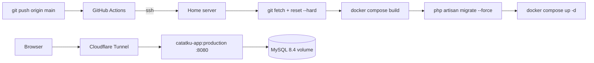

# Deployment

Target: a home server running the `production` stage of `docker/Dockerfile` behind a
Cloudflare Tunnel, deployed by a GitHub Actions workflow over SSH. No Railway, no
managed database: the app and its MySQL run as two containers on the same host.



## 1. Production image, verified locally

```bash
docker build -f docker/Dockerfile --target production -t catatku-prod .
```

The image is `php:8.4-apache` with `mod_rewrite`, the Vite assets copied from the Node
stage, `composer install --no-dev --optimize-autoloader`, and it runs as `www-data` on
`$PORT` (default 8080).

Run it against the local MySQL to prove it boots without the dev stack:

```bash
podman run -d --name catatku-prod-test --network catatku_default -p 8002:8080 \
  -e APP_ENV=production -e APP_DEBUG=false -e APP_KEY="$(php artisan key:generate --show)" \
  -e APP_URL=https://catatku.example.test -e APP_LOCALE=id -e LOG_CHANNEL=stderr \
  -e DB_CONNECTION=mysql -e DB_HOST=db -e DB_PORT=3306 \
  -e DB_DATABASE=catatku -e DB_USERNAME=catatku -e DB_PASSWORD=catatku \
  -e SESSION_DRIVER=database -e CACHE_STORE=database -e QUEUE_CONNECTION=sync \
  -e SESSION_SECURE_COOKIE=false catatku-prod
```

Result (real output):

```text
podman exec catatku-prod-test id      -> uid=33(www-data) gid=33(www-data)
GET /up                               -> 200
GET /                                -> 302, Location: https://localhost:8002/login
GET /login                            -> 200, contains name="_token"
GET /halaman-tidak-ada                -> 404, no stack trace, no vendor path
POST /login (budi@catatku.test)       -> 302, Location: https://localhost:8002/dashboard
GET /dashboard with the session       -> 200, shows "Budi Santoso"
mysql> SELECT COUNT(*) FROM sessions  -> 2
Set-Cookie: catatku-session=...; httponly; samesite=lax
```

With `SESSION_SECURE_COOKIE=true` (the production setting) the same cookie becomes
`secure; httponly; samesite=lax`.

Two pieces of code make that output possible:

- `bootstrap/app.php` -> `$middleware->trustProxies(at: '*')`, because the tunnel
  terminates TLS and only the forwarded headers reveal the real scheme and client IP.
- `AppServiceProvider::boot()` -> `URL::forceScheme('https')` in production, so
  generated URLs and redirects never fall back to `http`.

## 2. Server prerequisites

| Requirement | Why |
| --- | --- |
| Docker Engine + Compose v2 | `docker-compose.production.yml` is a Compose v2 file |
| Git | The workflow pulls `main` on the server |
| A clone at a fixed path, e.g. `/srv/catatku` | That path is the `APP_PATH` secret |
| Cloudflare Tunnel client | Terminates TLS and forwards to the app port |
| Port 8080 free (or `APP_PORT` set) | The app container publishes it |

## 3. First-time server setup

```bash
sudo mkdir -p /srv/catatku && sudo chown "$USER" /srv/catatku
git clone git@github.com:<owner>/Catatku.git /srv/catatku
cd /srv/catatku
cp .env.example .env
chmod 600 .env
```

Edit `.env` on the server. These values differ from development:

| Variable | Production value |
| --- | --- |
| `APP_ENV` | `production` |
| `APP_DEBUG` | `false` |
| `APP_KEY` | `php artisan key:generate --show` run once, then pasted |
| `APP_URL` | `https://catatku.<your-domain>` |
| `LOG_CHANNEL` | `stderr` |
| `SESSION_SECURE_COOKIE` | `true` |
| `DB_HOST` | `db` |
| `DB_PASSWORD` / `DB_ROOT_PASSWORD` | real secrets, not the example values |
| `APP_PORT` | host port for the app container, default `8080` |

`.env` is untracked, so the deploy's `git reset --hard` never overwrites or deletes it.

First boot:

```bash
docker compose -f docker-compose.production.yml build
docker compose -f docker-compose.production.yml run --rm app php artisan migrate --force
docker compose -f docker-compose.production.yml run --rm app php artisan db:seed --force
docker compose -f docker-compose.production.yml up -d
```

`db:seed --force` runs exactly once: the seeders are not idempotent and would duplicate
the demo rows on every deploy, which is why the workflow never calls them.

## 4. GitHub Actions secrets

The workflow (`.github/workflows/deploy.yml`) runs on every push to `main` and on
`workflow_dispatch`.

| Secret | Content |
| --- | --- |
| `SSH_HOST` | hostname or IP the runner connects to |
| `SSH_USER` | user that owns the clone and can run `docker` |
| `SSH_PRIVATE_KEY` | private key of a deploy keypair, newline-safe |
| `APP_PATH` | absolute path of the clone, e.g. `/srv/catatku` |

The workflow does, over SSH:

1. `git fetch --prune origin main` + `git reset --hard origin/main`
2. `docker compose -f docker-compose.production.yml build`
3. `docker compose -f docker-compose.production.yml run --rm app php artisan migrate --force`
4. `docker compose -f docker-compose.production.yml up -d --remove-orphans`

Migrations run with the new image while the previous container still serves traffic, so
a failed migration leaves the running app untouched.

## 5. Cloudflare Tunnel

Point a public hostname at the app port, for example in `~/.cloudflared/config.yml`:

```yaml
tunnel: catatku
ingress:
  - hostname: catatku.<your-domain>
    service: http://localhost:8080
  - service: http_status:404
```

`cloudflared` sends `X-Forwarded-Proto: https`, which is why the trusted-proxy
configuration above matters.

## 6. Live verification checklist

Run these against `https://catatku.<your-domain>` after the first deploy:

- [ ] `GET /` -> `302` to `/login` with an `https` location
- [ ] `GET /login` -> `200`, form contains `name="_token"`
- [ ] `POST /login` without a token -> `419`
- [ ] login `budi@catatku.test` / `password` -> dashboard shows the user name
- [ ] `POST /logout` -> back to `/login`, and `/dashboard` redirects again
- [ ] response cookie is `secure; httponly; samesite=lax`
- [ ] `GET /halaman-tidak-ada` -> the Indonesian 404 page, no stack trace
- [ ] `GET /up` -> `200`

## 7. Problems found and how they were fixed

| Problem | Fix |
| --- | --- |
| Redirects pointed at `http://` behind the TLS proxy | `trustProxies(at: '*')` + `URL::forceScheme('https')` in production |
| `SESSION_SECURE_COOKIE` at its default would send the session over http | Set to `true` on the server; the `secure` flag was verified on a local production container |
| `docker build .` fails because the Dockerfile is not at the repository root | Always build with `-f docker/Dockerfile` |
| `config:cache` is not run at build time, so no `.env` values are baked into the image | Configuration is read from the injected environment at runtime |
| A failing migration would take the old container down if it ran after `up -d` | The workflow migrates before `up -d` |
| `podman-compose` keeps the old container after a rebuild on the dev machine | `docker compose up -d --build --force-recreate app` |

## 8. Subsequent deploys

```bash
git push origin main        # GitHub Actions rebuilds, migrates and restarts
```

Production database changes happen only through `php artisan migrate --force`. Never run
`migrate:fresh`, `db:wipe` or `migrate:rollback` against the server database.
