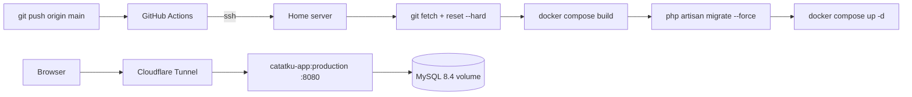

# Deployment

Target: a home server running the `production` stage of `docker/Dockerfile` behind a
Cloudflare Tunnel, deployed by a GitHub Actions workflow over SSH. No Railway, no
managed database: the app and its MySQL run as two containers on the same host.



## 1. Production image, verified locally

```bash
docker build -f docker/Dockerfile --target production -t catatku-prod .
```

The image is `php:8.4-fpm` with `nginx` in front of it: nginx answers on `$PORT` (default
8080) and forwards `.php` requests to php-fpm on `127.0.0.1:9000`. Both processes run as
`www-data`, and `docker/entrypoint.sh` starts them, forwards `SIGTERM`, and exits the
container when either one dies so a broken pool never sits behind a green health check.
The Vite assets come from the Node stage and `composer install --no-dev
--optimize-autoloader` runs at build time.

`docker/entrypoint.sh` also keeps `compose run app php artisan ...` working: with an argument
it `exec`s that command instead of starting the web server, which is how the deploy migrates.
`docker/php-fpm.conf` sets `clear_env = no`, otherwise php-fpm wipes the environment and
Laravel never sees `APP_KEY`, `DB_PASSWORD` and the rest.

Run it against the local MySQL to prove it boots without the dev stack:

```bash
podman run -d --name catatku-prod-test --network catatku_default -p 8002:8080 \
  -e APP_ENV=production -e APP_DEBUG=false -e APP_KEY="$(php artisan key:generate --show)" \
  -e APP_URL=https://catatku.example.test -e APP_LOCALE=id -e LOG_CHANNEL=stderr \
  -e DB_CONNECTION=mysql -e DB_HOST=db -e DB_PORT=3306 \
  -e DB_DATABASE=catatku -e DB_USERNAME=catatku -e DB_PASSWORD=catatku \
  -e SESSION_DRIVER=database -e CACHE_STORE=database -e QUEUE_CONNECTION=sync \
  -e SESSION_SECURE_COOKIE=false catatku-prod
```

Result (real output):

```text
podman exec catatku-prod-test id      -> uid=33(www-data) gid=33(www-data)
GET /up                               -> 200
GET /                                -> 302, Location: https://localhost:8002/login
GET /login                            -> 200, contains name="_token"
GET /halaman-tidak-ada                -> 404, no stack trace, no vendor path
POST /login (budi@catatku.test)       -> 302, Location: https://localhost:8002/dashboard
GET /dashboard with the session       -> 200, shows "Budi Santoso"
mysql> SELECT COUNT(*) FROM sessions  -> 2
Set-Cookie: catatku-session=...; httponly; samesite=lax
```

With `SESSION_SECURE_COOKIE=true` (the production setting) the same cookie becomes
`secure; httponly; samesite=lax`.

Two pieces of code make that output possible:

- `bootstrap/app.php` -> `$middleware->trustProxies(at: '*')`, because the tunnel
  terminates TLS and only the forwarded headers reveal the real scheme and client IP.
- `AppServiceProvider::boot()` -> `URL::forceScheme('https')` in production, so
  generated URLs and redirects never fall back to `http`.

## 2. Server prerequisites

| Requirement | Why |
| --- | --- |
| Docker Engine + Compose v2 | `docker-compose.production.yml` is a Compose v2 file |
| Git | The workflow pulls `main` on the server |
| `git` and `docker` installed system wide | The remote steps run `sh -l -s` and search `PATH`, `/usr/bin`, `/usr/local/bin`, `/bin`, `/snap/bin`, `~/.local/bin`, `~/bin` and `~/.nix-profile/bin`; a tool that exists only inside one interactive shell profile is not found |
| A clone at a fixed path, e.g. `/srv/catatku` | That path is the `APP_PATH` secret |
| Cloudflare Tunnel client | Terminates TLS and forwards to the app port |
| Port 8080 free (or `APP_PORT` set) | The app container publishes it |

## 3. First-time server setup

```bash
sudo mkdir -p /srv/catatku && sudo chown "$USER" /srv/catatku
git clone git@github.com:<owner>/Catatku.git /srv/catatku
cd /srv/catatku
cp .env.example .env
chmod 600 .env
```

Edit `.env` on the server. These values differ from development:

| Variable | Production value |
| --- | --- |
| `APP_ENV` | `production` |
| `APP_DEBUG` | `false` |
| `APP_KEY` | `php artisan key:generate --show` run once, then pasted |
| `APP_URL` | `https://catatku.<your-domain>` |
| `LOG_CHANNEL` | `stderr` |
| `SESSION_SECURE_COOKIE` | `true` |
| `DB_HOST` | `db` |
| `DB_DATABASE` / `DB_USERNAME` | database name and user for this server (keep the example values if you like) |
| `DB_PASSWORD` / `DB_ROOT_PASSWORD` | real secrets, not the example values |
| `APP_PORT` | host port for the app container, default `8080`; set `127.0.0.1:8080` when `cloudflared` runs on the same host |

Everything else stays as it is in `.env.example`: `SESSION_DRIVER=database`,
`CACHE_STORE=database`, `QUEUE_CONNECTION=sync`, `APP_LOCALE=id`, `DB_CONNECTION=mysql`,
`DB_PORT=3306`.

`.env` is untracked, so the deploy's `git reset --hard` never overwrites or deletes it.

`APP_PATH` may be written as `~/catatku`: the remote scripts expand a leading `~` against the
home of the user the runner logs in as, and print the resolved path before touching anything.
Both remote scripts quote the variable, so without that expansion `cd "~/catatku"` would look
for a directory literally named `~`. An absolute path is still less surprising if you ever
change `SSH_USER`.

Then authorize the deploy key. On your own machine, print the public half of the key whose
private half went into `SSH_PRIVATE_KEY`:

```bash
ssh-keygen -y -f ~/.ssh/catatku_deploy          # prints ssh-ed25519 AAAA... comment
ssh-keygen -lf ~/.ssh/catatku_deploy.pub        # the same key as a fingerprint
```

On the server, append exactly that line to the account the runner logs in as:

```bash
mkdir -p ~/.ssh && chmod 700 ~/.ssh
printf '%s\n' 'ssh-ed25519 AAAA... comment' >> ~/.ssh/authorized_keys
chmod 600 ~/.ssh/authorized_keys
ssh-keygen -lf ~/.ssh/authorized_keys           # must print the fingerprint above
```

The workflow prints the fingerprint of the key it received before it connects, so the two
numbers can be compared in one glance. A mismatch is the single most common reason for a
`Permission denied (publickey)` on the first run.

First boot:

```bash
compose="docker compose -f docker-compose.production.yml"

$compose build
$compose up -d db

# migrate fails with "Connection refused" if the database is still starting:
# `compose run` does not honour the healthcheck condition on every implementation.
until $compose exec -T db sh -c \
  'mysqladmin ping --host=127.0.0.1 --user=root --password="$MYSQL_ROOT_PASSWORD"' >/dev/null 2>&1; do
  sleep 2
done

$compose run --rm app php artisan migrate --force
$compose run --rm app php artisan db:seed --force   # once only
$compose up -d
```

If the loop never ends, `$compose logs db` says why (a wrong `DB_ROOT_PASSWORD` is the usual
cause: MySQL only applies it when the data volume is created).

`db:seed --force` runs exactly once: the seeders are not idempotent and would duplicate
the demo rows on every deploy, which is why the workflow never calls them.

## 4. GitHub Actions secrets

The workflow (`.github/workflows/deploy.yml`) runs on every push to `main` and on
`workflow_dispatch`.

| Secret | Content | Where the value comes from |
| --- | --- | --- |
| `SSH_HOST` | hostname the runner connects to | the SSH hostname published through the tunnel, e.g. `ssh.<domain>` (see §4b). **Not** an IP address when the server has no public one |
| `SSH_USER` | user that owns the clone and can run `docker` | `whoami` on the server |
| `SSH_PRIVATE_KEY` | whole private key, from `-----BEGIN` to `-----END` | `ssh-keygen -t ed25519 -f ~/.ssh/catatku_deploy -N ""` then `cat ~/.ssh/catatku_deploy`; the matching `.pub` goes into the server's `~/.ssh/authorized_keys` |
| `APP_PATH` | path of the clone on the server | `pwd` inside the clone, e.g. `/srv/catatku`. A leading `~` is accepted and expanded against the login user's home, so `~/catatku` works too |
| `CF_ACCESS_CLIENT_ID` | Access service token id, `<32 hex>.access` | Zero Trust → Access → Service credentials → Service tokens (see §4b). Optional: only when the host is reached through the tunnel |
| `CF_ACCESS_CLIENT_SECRET` | the matching secret, `cfast_…` or 64 hex | same screen, shown only once at creation |

`CF_ACCESS_CLIENT_ID` and `CF_ACCESS_CLIENT_SECRET` are optional as a pair: set both to go
through the tunnel, leave both empty for a host with a public SSH port. Setting only one fails
the first step with an explicit message.

Nothing else has to be configured in GitHub: the workflow does not use `GITHUB_TOKEN`, so no
Actions permission changes are needed. Database passwords live in the server's `.env` (§3) and
never become repository secrets.

Secrets are write-only: the UI and the REST API return only the name and timestamps, never the
value, because they are sealed with libsodium and decrypted only inside the runner. A value can
therefore only be reused from another repository if you still hold the plaintext — the key file
on your machine, or a freshly created Cloudflare token. Do not try to copy a secret by printing
it from a workflow: log redaction is best effort, a transformed value is not redacted, and the
value would then live in a build log.

The workflow does, over SSH:

0. checks the Access service token against the SSH hostname (a `302` means the policy is not
   Service Auth, `401`/`403` means the token is not accepted)
1. verifies the login, the clone and `docker compose version` before touching anything
2. `git fetch --prune origin main` + `git reset --hard origin/main`
3. `docker compose -f docker-compose.production.yml build`
4. `docker compose -f docker-compose.production.yml up -d db` and waits for the healthcheck
5. `docker compose -f docker-compose.production.yml run --rm app php artisan migrate --force`
6. `docker compose -f docker-compose.production.yml up -d --remove-orphans`

Migrations run with the new image while the previous container still serves traffic, so
a failed migration leaves the running app untouched. The workflow never seeds: run
`db:seed --force` once by hand on a fresh database (§3).

## 4b. SSH through Cloudflare Tunnel (no public IP)

The runner sits on the public internet, so `ssh` to the server only works if port 22 is
reachable. When the host has no public IP, publish SSH through the same tunnel and let
`cloudflared` on the runner open the connection — the tunnel is outbound from the server, so
no inbound port is ever opened.

1. **Publish the SSH route.** Dashboard → **Networking** → **Tunnels** → your tunnel →
   **Routes** → **Add route** → **Published application**. Pick your zone and the subdomain
   `ssh`, then set the service to **SSH** with `localhost:22` (or `<server IP>:22` when the
   tunnel runs on a different machine than the SSH server).
2. **Protect it with Access.** Zero Trust → **Access** → **Applications** → add a
   self-hosted application for `ssh.<domain>` with a policy whose action is **Service Auth**.
   Without this, Access asks for a browser login that the runner cannot complete.
3. **Create the token.** Zero Trust → **Access** → **Service credentials** → **Service
   tokens** → **Create Service Token**. Copy the Client ID (`<32 hex>.access`) and the Client
   Secret (shown once; `cfast_…` on new accounts, 64 hex on older ones).
4. **Fill the secrets.** `SSH_HOST=ssh.<domain>`, `CF_ACCESS_CLIENT_ID`,
   `CF_ACCESS_CLIENT_SECRET` — see the table in §4.

The workflow then downloads `cloudflared` and writes this `~/.ssh/config` (mode 600):

```text
Host ssh.<domain>
  User deploy
  IdentityFile ~/.ssh/deploy_key
  IdentitiesOnly yes
  StrictHostKeyChecking accept-new
  ProxyCommand ~/.local/bin/cloudflared access ssh --hostname %h --service-token-id <id> --service-token-secret <secret>
```

The token is passed as flags instead of `TUNNEL_SERVICE_TOKEN_ID` / `TUNNEL_SERVICE_TOKEN_SECRET`
because `cloudflared access ssh` does not honour those variables on every version; the flags
work everywhere. `StrictHostKeyChecking accept-new` pins the host key on the first connection
and refuses a changed key afterwards. The runner is destroyed when the job ends, so the copy of
the token on disk only lives for the duration of the deploy.

Reproduce the exact same path from your laptop before trusting CI:

```bash
ssh -F ~/.ssh/config deploy@ssh.<domain> 'cd /srv/catatku && git log -1 --oneline'
```

with the `ProxyCommand` line above in your own `~/.ssh/config`, or directly:

```bash
cloudflared access ssh --hostname ssh.<domain> \
  --service-token-id "$CF_ACCESS_CLIENT_ID" \
  --service-token-secret "$CF_ACCESS_CLIENT_SECRET"
```

If the host does have a public IP and port 22 open, skip this section entirely: leave both
`CF_*` secrets empty and the workflow falls back to `ssh-keyscan` plus a plain `ssh`.

## 4c. Common workflow failures

The `Verify the SSH connection` step first runs a one-line command (`echo connected`) and only
then the longer script over stdin, so a broken tunnel, key or login is reported separately from
a failing remote check. Every failure message also carries the exit status and the tail of the
output, because the runner log needs authentication to read while the annotation does not.

| Symptom | Cause | Fix |
| --- | --- | --- |
| `Check required secrets` fails with "is empty or missing" | a secret name is misspelled or the value is empty | recreate it with the exact name: `SSH_HOST`, `SSH_USER`, `SSH_PRIVATE_KEY`, `APP_PATH` |
| `Check required secrets` fails on the key format | the private key was pasted partially (one line only) | paste the whole file, from `-----BEGIN` to `-----END ...-----` |
| `Check required secrets` fails with `CF_ACCESS_CLIENT_ID is set but ...` | only one half of the token pair is set | fill in both, or clear both |
| `Set up SSH` fails with "Cannot reach ... on port 22" | the host has no public IP | use §4b, then set `SSH_HOST` to the tunnel hostname |
| `Check Cloudflare Access` fails with HTTP 302 | the Access policy is not **Service Auth** | set the policy action of the `ssh.<domain>` application to Service Auth and include the service token in that policy |
| `Check Cloudflare Access` fails with HTTP 401/403 | the token is wrong, expired, revoked, or no policy covers it | rotate or recreate the token, then check the policy includes it |
| `Check Cloudflare Access` fails with HTTP 000 | the hostname cannot be reached at all | check the published route and that `cloudflared` runs on the server |
| `Validate the deploy key` fails with "cannot be read as a private key" | the secret lost its newlines, was truncated, or has a passphrase | paste the whole file again with real newlines and without a passphrase |
| `Verify the SSH connection` fails with "Permission denied" | the key that arrived is not in `authorized_keys` of `SSH_USER`, or that account cannot log in | compare the fingerprints of the two (§3) |
| `Verify the SSH connection` fails with `sh: bash: not found` (exit 127) | the server has no `bash`; the login shell is `sh` or the image is busybox based | nothing to fix on the server: the remote scripts are POSIX `sh` on purpose, so this only appears when an edit reintroduces `bash -s` or `pipefail` |
| `Verify the SSH connection` fails with "git is not installed on the server" / "docker is not installed" | the tool is missing, or lives in a directory no non-interactive shell searches | install it system wide (`apt install git docker.io`, `apk add git docker`) or symlink it into `/usr/local/bin`. The step already searches `PATH`, `/usr/bin`, `/usr/local/bin`, `/bin`, `/snap/bin`, `~/.local/bin`, `~/bin` and `~/.nix-profile/bin` |
| `Verify the SSH connection` fails with `sh: bash: not found` and the tools exist only for an interactive shell | the deploy user's shell is zsh or fish, so a POSIX login shell never loads its `PATH` | put the directory in `/etc/profile.d/` or `/usr/local/bin`, which every shell sees |
| `Verify the SSH connection` fails with "APP_PATH does not exist" | the repository is not cloned yet, or the path is relative to a home other than the login user's | the message prints the resolved path; clone the repository there (§3) |
| `Verify the SSH connection` fails with "docker ... not available" | the user is not in the `docker` group | `sudo usermod -aG docker <user>`, then log in again |
| `Verify the SSH connection` fails with a handshake or a refused connection | the tunnel route points at the wrong host or port, or sshd is down | the route service must be `SSH` to `localhost:22` |
| `Pull, rebuild and migrate` cannot reach the database | wrong root password when the volume was created, or a port clash | `docker compose -f docker-compose.production.yml logs db` |
| `Pull, rebuild and migrate` fails elsewhere | `APP_PATH` is wrong, the clone is missing, or the build failed | run `cd "$APP_PATH"` and `docker compose version` by hand on the server |
| The workflow is green but the URL returns 404 | the container runs but the tunnel route does not point at it | check the `cloudflared` ingress, see §5 |

## 5. Cloudflare Tunnel

Point a public hostname at the app port, for example in `~/.cloudflared/config.yml`:

```yaml
tunnel: catatku
ingress:
  - hostname: catatku.<your-domain>
    service: http://localhost:8080
  - service: http_status:404
```

`cloudflared` sends `X-Forwarded-Proto: https`, which is why the trusted-proxy
configuration above matters.

## 6. Live verification checklist

Run these against `https://catatku.<your-domain>` after the first deploy:

- [ ] `GET /` -> `302` to `/login` with an `https` location
- [ ] `GET /login` -> `200`, form contains `name="_token"`
- [ ] `POST /login` without a token -> `419`
- [ ] login `budi@catatku.test` / `password` -> dashboard shows the user name
- [ ] `POST /logout` -> back to `/login`, and `/dashboard` redirects again
- [ ] response cookie is `secure; httponly; samesite=lax`
- [ ] `GET /halaman-tidak-ada` -> the Indonesian 404 page, no stack trace
- [ ] `GET /up` -> `200`

## 7. Problems found and how they were fixed

| Problem | Fix |
| --- | --- |
| Redirects pointed at `http://` behind the TLS proxy | `trustProxies(at: '*')` + `URL::forceScheme('https')` in production |
| `SESSION_SECURE_COOKIE` at its default would send the session over http | Set to `true` on the server; the `secure` flag was verified on a local production container |
| `docker build .` fails because the Dockerfile is not at the repository root | Always build with `-f docker/Dockerfile` |
| `config:cache` is not run at build time, so no `.env` values are baked into the image | Configuration is read from the injected environment at runtime |
| A failing migration would take the old container down if it ran after `up -d` | The workflow migrates before `up -d` |
| `podman-compose` keeps the old container after a rebuild on the dev machine | `docker compose up -d --build --force-recreate app` |
| nginx as `www-data` refused to start: `mkdir() "/var/lib/nginx/uwsgi" failed (13: Permission denied)` | All five temp paths (`client_body`, `proxy`, `fastcgi`, `uwsgi`, `scgi`) are pointed at `/tmp` in `docker/nginx.conf` |
| php-fpm would hide the injected environment from Laravel | `clear_env = no` in `docker/php-fpm.conf` |
| The `migrate` step would start a web server instead of the command | `docker/entrypoint.sh` `exec`s its arguments when it gets any |

## 8. Subsequent deploys

```bash
git push origin main        # GitHub Actions rebuilds, migrates and restarts
```

Production database changes happen only through `php artisan migrate --force`. Never run
`migrate:fresh`, `db:wipe` or `migrate:rollback` against the server database.

## 9. Final verification — local dry run of the production image

The server is not reachable from this machine yet, so the same steps the workflow runs were
executed against a **fresh database** with the built image before deploying. This is the
closest possible rehearsal of the live checklist.

```bash
docker build -f docker/Dockerfile --target production -t catatku-prod:final .
# fresh database, so the seeders run on an empty schema
mysql -e "CREATE DATABASE catatku_prod; GRANT ALL ON catatku_prod.* TO 'catatku'@'%';"

podman run -d --name catatku-final --network catatku_default -p 8004:8080 \
  -e APP_ENV=production -e APP_DEBUG=false -e APP_KEY=... -e APP_URL=https://catatku.contoh.test \
  -e DB_HOST=db -e DB_DATABASE=catatku_prod -e DB_USERNAME=catatku -e DB_PASSWORD=... \
  -e SESSION_DRIVER=database -e CACHE_STORE=database -e QUEUE_CONNECTION=sync \
  -e SESSION_SECURE_COOKIE=false catatku-prod:final

podman exec catatku-final php artisan migrate --force
podman exec catatku-final php artisan db:seed --force
```

Result (real output, 1 November 2026, nginx + php-fpm image):

```text
docker exec catatku-nginx id              -> uid=33(www-data) gid=33(www-data)
GET  /up                                  -> 200
GET  /                                    -> 302 https://localhost/login
GET  /login                               -> 200, 1 csrf field
POST /login without a token               -> 419
POST /login (budi@catatku.test)           -> 302 https://localhost/dashboard
   Set-Cookie: catatku-session=...; httponly; samesite=lax
GET  /dashboard?month=2026-10             -> 200, Rp 9.500.000 / Rp 1.190.000 / Rp 8.310.000,
                                             chart data attribute present
GET  /transactions                        -> 200, "Halaman 1 dari 2"
GET  /transactions?month=2026-08&type=income -> 200
GET  /wallets, /categories                -> 200, 200
GET  /build/assets/app-*.css              -> 200, text/css (served by nginx, not PHP)
GET  /tidak-ada                           -> 404, no stack trace
POST /transactions (valid, 1250000)       -> 302, row count 60 -> 61
POST /transactions (formatted 1.250.000)  -> 302 back to the form, rejected
POST /transactions (future date)          -> 302 back to the form, rejected
POST /transactions (income category as expense) -> 302 back to the form, rejected
POST /transactions (another user's wallet)      -> 302 back to the form, rejected
admin GET /admin/users                    -> 200
budi  GET /admin/users                    -> 403
POST /logout                              -> 302 https://localhost/login
GET  /dashboard after logout              -> 302 https://localhost/login
docker run --rm <image> php artisan --version -> Laravel Framework 13.39.0 (entrypoint passthrough)
kill the php-fpm master                   -> container exits with code 1
```

The dashboard was read with `?month=2026-10` because the seed data ends in October 2026 and
the default month is the current one; with no rows the three cards correctly show `Rp 0`.

`SESSION_SECURE_COOKIE` is `false` in this rehearsal because the container is reached over
plain HTTP on localhost; with `true` the same cookie carries `secure` (verified in §1).

The scratch database and container were removed afterwards:
`DROP DATABASE catatku_nginx_prod`, `docker rm -f catatku-nginx-test`. The development
database was not touched (`transactions=60` before and after).

### What is still unverified

- The live host itself: DNS, Cloudflare Tunnel routing, the six Actions secrets, and the
  server's `.env`. These cannot be exercised without access.
- Visual rendering in a browser (chart, 375px layout) and the screenshots in
  `docs/submission-checklist.md` §3.
- The `v1.0.0` tag is intentionally **not** created yet: it should mark a commit that passed
  the live checklist, not a rehearsal.

## 10. Rehearsal of the deploy script itself

The HTTP checks in §9 exercise the image, not the workflow. The remote part of
`.github/workflows/deploy.yml` was therefore extracted verbatim and executed against a copy of
the repository (`/tmp/opencode/fakeserver`) with its own MySQL volume and `APP_PORT=8005`, to
find ordering bugs before CI hits the real server.

```bash
# the heredoc body of the "Pull, rebuild and migrate" step, run locally
APP_PATH=/tmp/opencode/fakeserver bash /tmp/opencode/remote-body.sh
```

Real output (1 November 2026), with build lines removed:

```text
Successfully tagged localhost/catatku-app:production
INFO  Preparing database.
INFO  Running migrations.
  0001_01_01_000000_create_users_table .............. 52.61ms DONE
  0001_01_01_000001_create_cache_table .............. 94.69ms DONE
  0001_01_01_000002_create_sessions_table ........... 59.43ms DONE
  2026_10_31_000001_create_wallets_table ............ 111.69ms DONE
  2026_10_31_000002_create_categories_table ......... 125.87ms DONE
  2026_10_31_000003_create_transactions_table ....... 384.79ms DONE
CONTAINER ID  IMAGE                             STATUS                       PORTS
0b3805055daf  docker.io/library/mysql:8.4       Up (healthy)                 3306/tcp, 33060/tcp
32d79b260894  localhost/catatku-app:production  Up                           0.0.0.0:8005->8080/tcp
EXIT=0
--- .env ---
1129 .env
GET /up -> 200
GET /login -> 200
```

What the rehearsal proved, beyond "it runs":

| Check | Result |
| --- | --- |
| `git reset --hard origin/main` keeps the untracked `.env` | the 1129-byte file survived and the app booted with it |
| The database wait works on a cold volume | `migrate` ran only after `mysqladmin ping` succeeded; before the fix the same script died with `SQLSTATE[HY000] [2002] Connection refused` |
| `compose run --rm app migrate` runs the new image | all 6 migrations executed inside the throwaway container, before the app was restarted |
| `compose up -d --remove-orphans` leaves a working pair | `db` healthy, `app` serving, `/up` and `/login` both `200` |
| The script is valid shell before CI ever runs it | `bash -n` clean on every step body |

Two portability problems were found and fixed this way:

1. `compose run` ignored `depends_on: service_healthy`, so migrations raced MySQL. The step now
   starts `db` explicitly and polls `mysqladmin ping` for up to 120 seconds.
2. `$(compose ps -q db)` plus `docker inspect` was rejected by `podman-compose`
   (`unrecognized arguments: db`). The ping loop avoids that call entirely, so the same script
   works with both Compose implementations.

The rehearsal stack was stopped with `docker compose -f docker-compose.production.yml down`
(no `-v`), so the test volume is still there for a repeat run.

The script was replayed a second time under `dash` after the remote interpreter was changed from
`bash` to POSIX `sh` (the server has no `bash`, see §4c), with the same result:

```text
INFO  Nothing to migrate.
bca5a2c17566  mysql:8.4                  Up 14 seconds (healthy)  3306/tcp, 33060/tcp
4652ebdfe59f  catatku-app:production     Up 1 second              0.0.0.0:8005->8080/tcp
EXIT=0
GET /up -> 200
GET /login -> 200
```

`Nothing to migrate` is expected: the volume from the first run is still there. A fresh volume
runs all six migrations, as shown above.
