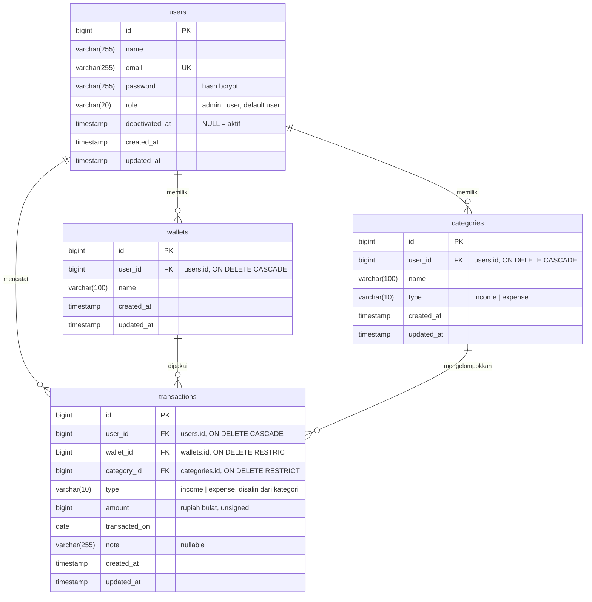

# ERD — Catatku

Empat tabel domain, ditambah tabel framework yang benar-benar dipakai
(`migrations`, `sessions`, `cache`, `cache_locks`).

## Constraint dan indeks

| Tabel | Constraint / indeks | Alasan |
| --- | --- | --- |
| `users` | unique `email` | satu akun per alamat email (disimpan lowercase) |
| `wallets` | unique `(user_id, name)` | nama dompet unik per pemilik, user berbeda boleh sama |
| `categories` | unique `(user_id, name, type)` | nama boleh sama untuk tipe berbeda |
| `transactions` | index `(user_id, transacted_on)` | semua daftar dan agregasi difilter pemilik lalu rentang tanggal |
| `transactions` | FK `wallet_id`, `category_id` RESTRICT | dompet/kategori tidak boleh hilang selama masih dipakai |
| `transactions` | FK `user_id` CASCADE | menghapus akun ikut menghapus datanya |

Keputusan `transactions.type` yang didenormalisasi (salinan dari `categories.type`) beserta
alasannya ada di `docs/decisions.md` D8; invariannya dijaga di `TransactionRequest`
dan diuji di `tests/Feature/TransactionTest.php`.

## Aturan turunan

- **Saldo dompet** = `SUM(income) - SUM(expense)` dari transaksi dompet itu, tanpa saldo
  awal (`DashboardController::walletBalances`).
- **Saldo bulan** = pemasukan bulan - pengeluaran bulan (`MonthlySummary::balance()`).
- Nominal disimpan sebagai bilangan bulat rupiah; tidak ada tipe float di skema.
