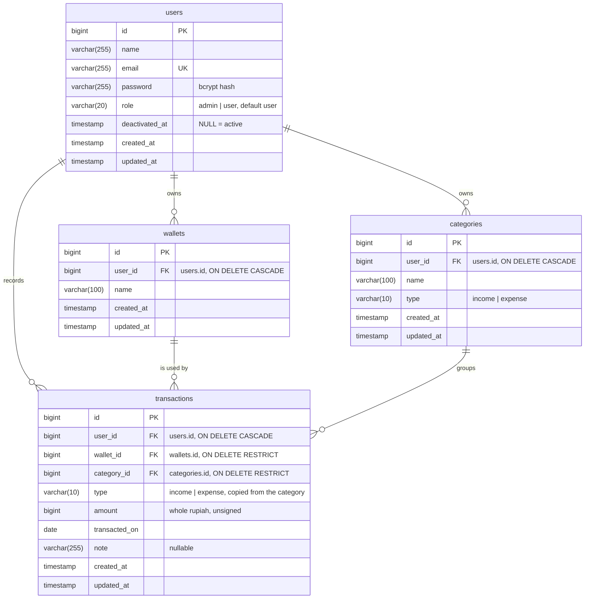

# ERD — Catatku

Four domain tables plus the framework tables that are actually used (`migrations`,
`sessions`, `cache`, `cache_locks`).

## Constraints and indexes

| Table | Constraint / index | Why |
| --- | --- | --- |
| `users` | unique `email` | one account per address (stored lowercase) |
| `wallets` | unique `(user_id, name)` | wallet names are unique per owner; two users may both have "Dompet" |
| `categories` | unique `(user_id, name, type)` | the same name may exist for both types |
| `transactions` | index `(user_id, transacted_on)` | every list and aggregation filters by owner, then by date range |
| `transactions` | FK `wallet_id`, `category_id` RESTRICT | a wallet or category cannot disappear while transactions use it |
| `transactions` | FK `user_id` CASCADE | deleting an account removes its data |

The denormalised `transactions.type` (a copy of `categories.type`) and its reasoning are
recorded as D8 in `docs/decisions.md`; the invariant is enforced in `TransactionRequest` and
covered by `tests/Feature/TransactionTest.php`.

## Derived values

- **Wallet balance** = `SUM(income) - SUM(expense)` over that wallet's transactions, with no
  opening balance (`DashboardController::walletBalances`).
- **Monthly balance** = income of the month - expense of the month
  (`MonthlySummary::balance()`).
- Amounts are whole rupiah; no float type exists in the schema.
